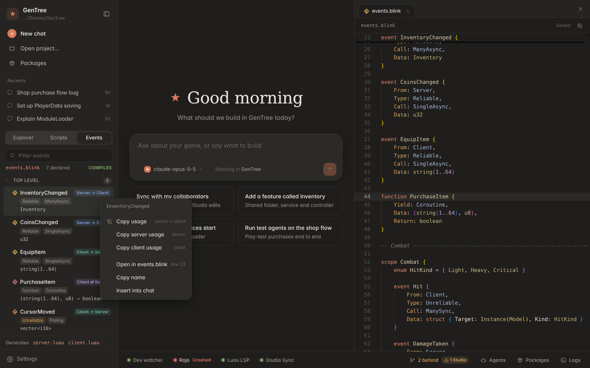
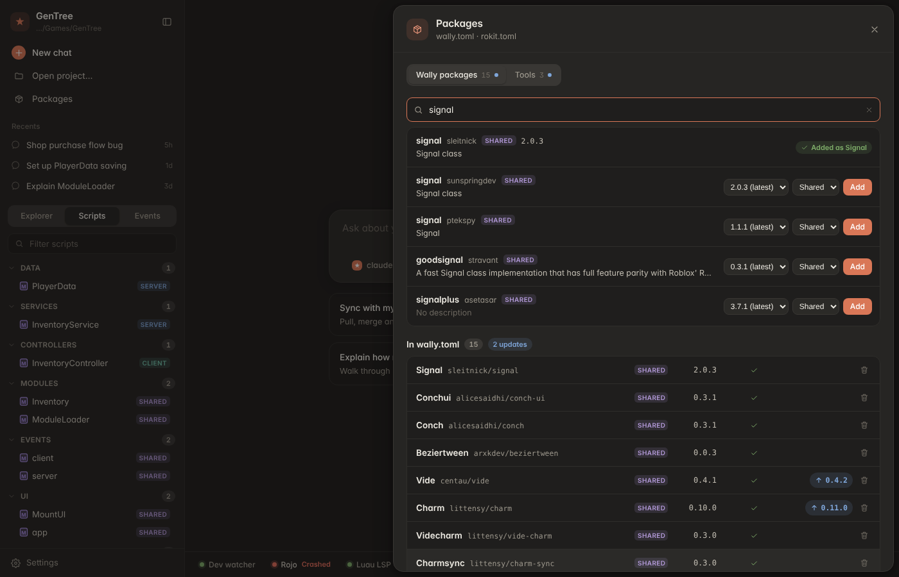

# RBX Forge

A desktop dev harness for Roblox games made from the GenTree template (MyTemplate-Legacy). Open a game folder and Forge runs the tooling for you, shows the game as a Roblox explorer and an organised script list, and gives you a Claude-style chat that can read, edit and test the game.


## Install

RBX Forge is built for macOS (Apple Silicon and Intel) and Windows (x64 and ARM) by GitHub Actions.

1. Download it:
   - **Releases** (tagged versions): [github.com/Acidgorgon/rbx-forge/releases](https://github.com/Acidgorgon/rbx-forge/releases).
   - **Latest build of `main`**: open [Actions > Build](https://github.com/Acidgorgon/rbx-forge/actions/workflows/build.yml), pick the newest green run, and download from **Artifacts** at the bottom (you need to be signed in to GitHub). Each artifact is a zip around the installer.

   | Your computer | File |
   |---|---|
   | Mac with Apple Silicon (M1/M2/M3/M4, most MacBook Airs since 2020) | `RBX-Forge-<version>-mac-arm64.dmg` |
   | Intel Mac | `RBX-Forge-<version>-mac-x64.dmg` |
   | Windows PC (most) | `RBX-Forge-<version>-win-x64.exe` |
   | Windows on ARM (Surface Pro X / Copilot+ PCs) | `RBX-Forge-<version>-win-arm64.exe` |

   Not sure which Mac you have: Apple menu > About This Mac. "Chip: Apple M…" means arm64; "Processor: Intel" means x64.

2. **macOS:** open the `.dmg` and drag **RBX Forge** into **Applications**. The app is not notarized by Apple (no paid developer certificate), so the first time:
   - In Applications, **right-click (or Control-click) RBX Forge > Open**, then **Open** in the dialog. After that it opens normally.
   - If macOS says the app "is damaged and can't be opened" or offers no Open button (newer macOS versions), go to **System Settings > Privacy & Security**, scroll down and click **Open Anyway**; or run this once in Terminal:
     ```bash
     xattr -dr com.apple.quarantine "/Applications/RBX Forge.app"
     ```

3. **Windows:** run the `.exe` installer. It is not code-signed, so SmartScreen shows "Windows protected your PC": click **More info > Run anyway**. Pick an install folder (or keep the default); the installer adds Desktop and Start menu shortcuts. Uninstall from Settings > Apps.

The app still needs your game's own tools: in the game folder run `rokit install` (rojo, wally, luau-lsp), and install Python 3 for Studio sync (on Windows, from python.org with the `py` launcher). Forge looks for tools in `~/.rokit/bin` (`%USERPROFILE%\.rokit\bin`), your PATH, Homebrew (`/opt/homebrew/bin`, `/usr/local/bin`), nvm, and on macOS your login shell's PATH, so it finds them even when started from the Dock or Finder. On Windows the dev loop runs `tools\dev.ps1` in PowerShell (or `./dev` with Git Bash when there is no `dev.ps1`).

Settings live in the same place for the installed app and `npm run dev`: `~/Library/Application Support/rbx-forge` (macOS), `%APPDATA%\rbx-forge` (Windows).

## Build it yourself

```bash
npm install
npm run dist        # installer for this computer (.dmg/.zip on a Mac, .exe on Windows) in dist/
npm run dist:mac    # macOS arm64 + x64 (run on a Mac)
npm run dist:win    # Windows x64 + arm64 (run on Windows; NSIS needs Windows or wine)
npm run dist:dir    # unpacked app only, quickest check
```

Packaging is configured in `electron-builder.yml`; the icon is `build/icon.png` (source `build/icon.svg`), converted to `.icns`/`.ico` by electron-builder.

The chat runs the Claude Agent SDK's native CLI from the npm package `@anthropic-ai/claude-agent-sdk-<platform>-<arch>`. npm installs only the one for the machine running `npm install`, so the `dist` scripts first run `build/sdk-binaries.mjs`, which downloads the package for each target platform/arch when it is missing (for example the x64 one when building Intel on an Apple Silicon Mac). The packages are unpacked from the asar (an executable cannot run from inside it) and `build/afterPack.cjs` removes the ones the target does not need, failing the build if its own is missing. In CI each target is built on its own runner (`.github/workflows/build.yml`): macOS arm64 on `macos-latest`, macOS x64 on `macos-15-intel`, Windows x64 and arm64 on `windows-latest`. Pushing a tag like `v0.2.0` also publishes a GitHub Release with all four installers.

macOS builds get an ad-hoc signature only. To sign and notarize, set `mac.identity` (or `CSC_LINK`/`CSC_KEY_PASSWORD`), `hardenedRuntime: true` and add notarization; Windows signing takes `CSC_LINK` / `WIN_CSC_LINK`.

## Run it from source

Needs Node 20+, and in the game folder the template's tools (`rokit install`), plus Python 3 for Studio sync.

```bash
npm install
npm run dev      # development, hot reload
npm run build    # production build into out/
npm start        # run the production build
```

Then **Open project** and pick a game folder (one with `default.project.json`). Forge remembers it.

## What it does

- **Services, automatic.** On open it starts the template's `./dev` loop (feature watcher, Blink, sourcemap, wally, Studio sync), `rojo serve`, and luau-lsp. Crashed processes restart with backoff. The status bar shows each one; click for Restart / Stop / Logs.
  - Forge will not run `./dev` inside the template repo itself, because `./dev` disconnects the template's git there. Add `.keep-git` (or set `allowTemplateDisconnect`) if you really want that.
- **Collaborator sync.** The git pill shows ahead/behind/conflicts. Sync now (or every N minutes) commits your work, pulls with rebase, falls back to a merge on conflict and lists conflicted files, then pushes. Never force-pushes. A new game folder has no git (the template's `./dev` removes it); **Init git** in the Sync drawer sets up your shared remote.
- **Studio sync.** Script edits made in Studio (Team Create) come back into the repo through `tools/studio-sync.py`. Conflicts show as a side-by-side diff with *Use Studio version* / *Keep repo version*.
- **Explorer.** The DataModel tree from `default.project.json` and `sourcemap.json`, merged with a live snapshot from the Studio plugin, so models, sounds and GUIs that only exist in Studio show up too (dimmed, marked *Studio*). Needs the template's live-tree plugin update.
- **Scripts.** Every script grouped as Configs, Data, Services, Controllers, Modules, Events, UI and Entry points, with realm and feature tags.
- **Copy path.** Right-click any node: Copy Roblox path (`game.ReplicatedStorage.Assets["Starter Sword"]`), Copy as GetService, Copy file path, Insert path into chat. Ctrl/Cmd-click to select several; Ctrl/Cmd+Shift+C copies.
- **Editor.** Monaco with Luau highlighting and luau-lsp (diagnostics, completion, hover, signature help, go to definition) using Roblox type definitions and API docs, downloaded once and cached.
- **Chat.** Pick a provider and model per chat from the pill under the message box. Every provider gets the same compact `gentree` toolset: project_overview, list_scripts, read_script, edit_script, write_script, explorer_tree, find_instance, new_feature, sync_collaborators, studio_conflicts, resolve_studio_conflict, service_logs, restart_service. Writes are limited to the Rojo folders and `events.blink`; Packages is off limits.
  - **Anthropic** (Claude Opus/Sonnet/Haiku 5.5) runs through the Claude Agent SDK, and is the only provider with Roblox Studio MCP tools and the read-only file tools.
  - **OpenAI**, **OpenRouter**, **Google Gemini** (its OpenAI-compatible endpoint), **Ollama** (local, `http://localhost:11434/v1`, no key) and **Custom** (any OpenAI-compatible base URL, optional key) run through Forge's own agent loop: streamed `/chat/completions` with function calling, the same system prompt, tools and write rules, a turn limit (`chatMaxTurns`, default 50) and Stop.
  - **Keys.** Settings (gear at the bottom of the sidebar) has a card per provider: paste a key (encrypted with the OS keychain via Electron safeStorage, never sent to the window), set the base URL for Ollama/Custom, and see which providers are ready. Keys in `ANTHROPIC_API_KEY`, `OPENAI_API_KEY`, `OPENROUTER_API_KEY` or `GEMINI_API_KEY` are used when nothing is stored. Model lists come from each provider's `GET /models` once a key is set, plus a few defaults; you can also type any model id in the picker.
  - **Claude Code login.** An Anthropic API key is Anthropic's documented way to authenticate apps built on the Agent SDK, and it is the default. *Use my Claude Code login (personal use only)* in Settings lets Forge fall back to the Claude Code login on this machine (or `CLAUDE_CODE_OAUTH_TOKEN`) when no key is set; that is for your own personal use and draws from your Claude Pro/Max plan limits. It is off by default.
- **Test agents.** Give one scenario per line and Forge runs them as parallel agents (3 at a time by default), each reporting passed or failed. If Roblox Studio's MCP server is configured (`studioMcp` setting), one agent at a time gets Studio access to play-test; the others review the code. The Agents drawer has its own model picker; Studio play-testing needs the Anthropic provider, so on other providers every agent is a code reviewer.

## Blink events

The **Events** tab (next to Explorer and Scripts) lists every `event` and `function` in `events.blink` and the files it imports, grouped by `scope`: direction (Server → Client / Client → Server), Reliable or Unreliable, the `Call` kind, and the `Data` shape. Click one to jump to its declaration; right-click → **Copy usage** copies the calls Blink generates for it (`Fire`/`FireAll`/`FireExcept`/`FireList`, `On`, `Iter` for polling, `Invoke`), with the `require` path worked out from `default.project.json` and the `ClientOutput`/`ServerOutput` options.

On every save of `events.blink` (or an import) Forge compiles a copy with the project's `blink` (from rokit) into a temp folder, so your real output files are never touched. If it fails you get a red banner in the Events tab, an error squiggle in the editor, and a `[blink]` line in the Dev loop log. `.blink` files get syntax highlighting. The generated `client.luau`/`server.luau` open read-only with a note to edit `events.blink` instead.

The template's `tools/dev.sh` currently runs `blink events.blink -w` with its output thrown away; `docs/template-dev-blink.patch` keeps it (console plus `.blink.log`).



## Packages

**Packages** in the status bar (or the sidebar) opens a drawer with two tabs.

- **Wally packages.** Search the Wally registry (the public API behind wally.run) and add a package with a version and a realm: *Shared* goes to `[dependencies]`, *Server* to `[server-dependencies]`, *Dev* to `[dev-dependencies]`. Server-only packages can't be added as shared. The alias follows the file's existing style (`Janitor`, `Videcharm`); Forge refuses an alias that another package already uses. Forge edits `wally.toml` one line at a time, so comments and order stay as they are. The `./dev` loop then runs `wally install`; if the loop isn't running, Forge runs `wally install` itself and shows the output in Logs. The list shows each dependency's installed version (from `wally.lock` and `Packages/`), any newer release with a one-click update, and a remove button.
- **Tools.** The project's `rokit.toml` tools show whether they're installed and whether a newer GitHub release exists (one click updates the version and runs `rokit install`). There's also a curated list to add from: luau-lsp, StyLua, selene, Blink, Zap, Lune, darklua, pesde, Rojo and Wally. You can also add any `owner/repo`. If luau-lsp is missing, Forge flags it at the top of the tab and in the status bar, because the editor depends on it. Release checks use the GitHub API without authentication (it uses `GITHUB_TOKEN` if set). The results are cached for an hour, and Forge pauses the checks while GitHub is rate limiting.



## Settings

Stored in the app's user data folder (`settings.json`): `defaultModel` (`{ "provider": "anthropic", "model": "claude-opus-5-5" }`; the older `model` string still works), `providerConfig` (base URLs for `ollama`/`custom`), `anthropicUseClaudeLogin` (default `false`), `chatMaxTurns`, `studioMcp` (`{ "command": "...", "args": [] }`), `allowBash`, `maxParallelAgents`, `agentMaxTurns`, `sync` (`autoSyncMinutes`, `autoCommit`), `allowTemplateDisconnect`.

## Layout

```
src/main        Electron main process
  services/     supervisor, git sync, Studio conflicts, project tree, luau-lsp bridge, settings, logs
  agent/        chat, gentree MCP tools, test agents, credentials
src/preload     the window.harness bridge
src/renderer    React UI (Monaco editor, panels, drawers); mock.ts powers a browser preview
src/shared      types shared by all three
test            node --test suites (npm test)
```

Browser preview with sample data: `npx vite --config src/renderer/vite.preview.config.ts`.

## Status

Built and tested headless: typecheck, 51 unit/integration tests (tree building, categories, git sync against real repos, Studio conflicts, MCP tools, agent scheduling, LSP framing and client), and a production build. Not yet run end to end in a real Electron window against a real game, Studio and API key.
