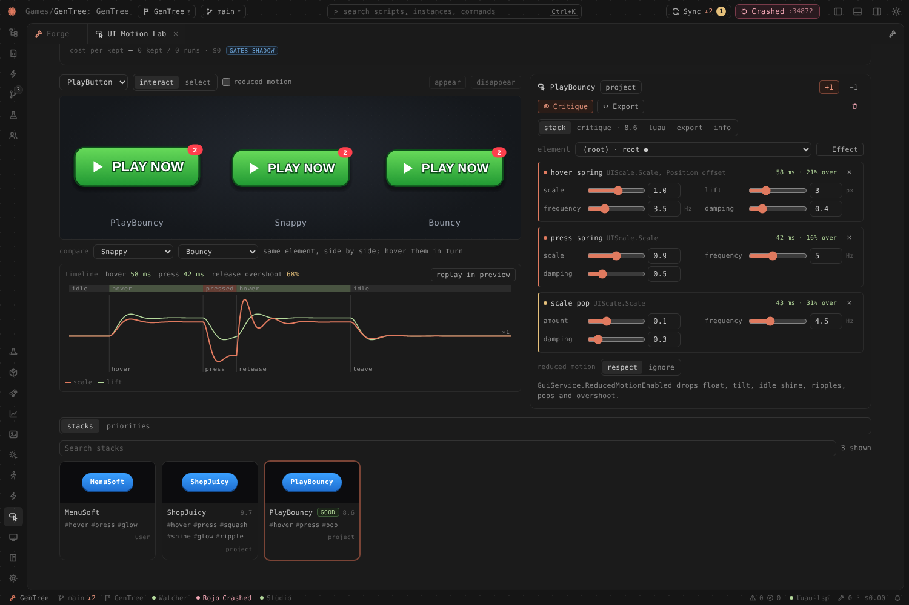

# RBX Forge


RBX Forge is a desktop workbench for Roblox games built on the GenTree template (MyTemplate-Legacy). Point it at a game folder, or have it create one, and it installs the toolchain, runs the dev loop, Rojo, luau-lsp and Studio sync for you. It shows the game the way Studio does, as a DataModel explorer, next to a code editor with full Luau intellisense, a terminal, Lune tests, Wally packages, Blink events, git sync for your team, releases and analytics. The AI assistant works on the same project with the same tools. It can use Claude, OpenAI, Gemini, OpenRouter, Ollama or any OpenAI-compatible model, pull other models into a group chat, split big jobs across a team of agents, remember how you work, and generate game art that it uploads to Roblox.

- [Feature tour](#feature-tour)
- [Install](#install)
- [Build it yourself](#build-it-yourself)
- [Settings](#settings)
- [Layout](#layout)

## Feature tour

### Editor with luau-lsp intellisense

Monaco with Luau and Blink highlighting, driven by luau-lsp: diagnostics, completion, hover, signature help and go to definition. It uses the Roblox type definitions and API docs, which are downloaded once and cached. The bottom panel has Output (filterable by service), Problems, the Dev and Rojo logs and the terminal. When a script also changed in Studio, a banner offers **Compare**. Ctrl/Cmd+K opens the command palette, which searches scripts, instances and commands.

The editor is in the screenshot at the top of this page.

### Explorer, scripts and Studio two-way sync


- **Explorer.** The DataModel tree from the Rojo project and `sourcemap.json`, merged with a live snapshot from the Studio plugin. Models, sounds and GUIs that exist only in Studio show up too, marked *Studio*. The **Files** and **Features** tabs show the same project by folder and by GenTree feature.
- **Create from the tree.** Right-click > **New** adds a ModuleScript, Script or LocalScript, a folder, a whole GenTree feature (shared module + server service + client controller) or a Blink event.
- **Copy paths.** **Copy Roblox path** (`game.ReplicatedStorage.Shared.Features.Inventory`), **Copy as GetService**, slash path, **Copy require(…)** and **Copy file path**.
- **Scripts.** Every script grouped as Configs, Data, Services, Controllers, Modules, Events, UI and Entry points, with realm and feature tags.


- **Studio sync, both ways.** Rojo pushes files into Studio. Edits made in Studio (including Team Create) come back into the repo through [Forge Sync](#forge-sync-studio-first-then-rojo), or the project's own `tools/studio-sync.py` when you pick it in Settings > Sync. When a file changed in both places it is held under `.studio-sync/conflicts` and opens as a side-by-side diff where you pick the Studio or the repo version.
- **Collaborator sync.** Source control shows ahead/behind, incoming commits grouped by feature (with overlap warnings against your local changes), and a selene + StyLua pre-sync check. **Sync now** (or every N minutes) commits your work, pulls with rebase, falls back to a merge on conflict and pushes. It never force-pushes.

### Multi-place projects

Every `*.project.json` at the project root is a place. The place switcher in the title bar (and in the palette) changes which place Rojo serves, which sourcemap the explorer and luau-lsp read, and which place releases go to. **Serve all places** runs a `rojo serve` for each place on its own `servePort`.

### Forge Sync: Studio first, then Rojo


When a teammate edits scripts in Studio (Team Create) and you then connect Rojo, Rojo pushes your disk copy over their work. Forge Sync stops that, for every place and any Rojo project:

1. **Studio goes first.** When a place opens in Studio, the Forge Bridge plugin sends Forge everything under that place's mapped folders. Rojo serve for that place waits ("Waiting for Studio sync check").
2. **Forge reconciles three ways.** For each file it compares Studio, disk and the last version both agreed on. A teammate's change is written to disk; yours is left for Rojo to push; changes on both sides are merged line by line when they don't overlap. New folders made in Studio (a new move under `Moves/`), renames, deletes (moved to `.forge/sync/trash`, never removed) and non-script instances (an `Animations` folder becomes `.model.json`) come along too.
3. **Then Rojo serves.** If both sides changed the same lines, the place is held: open the conflict, compare **disk ⇄ studio**, **base → disk** or **base → studio**, and pick **Take Studio** or **Take disk** (or **Serve anyway**). A new Studio session for a place Rojo already serves stops that serve, re-checks, and restarts it.


- **First run.** With no shared version yet, a place whose Studio and disk differ asks once: **Studio wins** or **Disk wins**.
- **Commit teammate edits (N).** Files Forge wrote from Studio are committed on their own, as `Studio edits: Uppercut.luau, NewMove…`, and nothing else you changed is staged. Before a pull or a new feature branch, Forge commits them first (with *Commit local work before pulling* on) or warns you.
- **Old plugin.** If the project's `StudioSyncPlugin` (`FSFStudioSync.lua`, `RepoStudioSync.lua`) is still in Studio's Plugins folder, Source control offers **Disable it** (renamed to `*.disabled`). With Forge Sync on, `./dev` runs with `FORGE_SYNC=1` so the project's `studio-sync.py` stays off.
- **Settings > Sync.** *Studio sync*: **Forge (recommended)**, **Project script** (the old `tools/studio-sync.py` path) or **Off**; *Check Studio before Rojo serves* turns the gate off.


### Services that run themselves

When you open a project, Forge starts the template's `./dev` loop (feature watcher, Blink, sourcemap, Wally, Studio sync), `rojo serve` and luau-lsp. A crashed process restarts with backoff. The status bar and the Forge home page show each service, with Restart and Logs.

- Forge does not run `./dev` inside the template repo itself, because `./dev` disconnects the template's git there. Add `.keep-git` (or set `allowTemplateDisconnect`) if you really want that.

### Terminal


A real terminal (xterm.js on node-pty) in the bottom panel, opened in the project folder with the Roblox tools on its PATH. It has tabs, a shell picker, find in the scrollback, and one-click tasks for the project's commands. File paths in the output are links that open in the editor. When the assistant wants to run a command (`wally install` above), it asks first, and the command runs in your terminal only after you click **Run**.

### New project and automatic toolchain


- **Toolchain setup.** Forge ships rokit. On first launch it installs rokit and the pinned tools into `~/.rokit/bin` for your user only, with no admin rights: **rojo, wally, blink, lune, luau-lsp, selene, stylua** and wally-package-types. Each project still uses the versions pinned in its own `rokit.toml`. Forge runs `rokit install` for a project whose known tools are missing. Re-run it from **Settings > Toolchain**.
- **New project.** Fetches the GenTree template (or makes an empty Rojo project), removes the template's history, names the project, runs `git init` and the first commit with your team's remote, then installs tools and packages and compiles the Blink events.
- **Join project.** Clones a teammate's game and runs `rokit install` and `wally install`.

### AI assistant: providers, effort and images


The assistant panel is a chat with project tools: overview, list/read/edit/write scripts, explorer tree, find instance, new feature, Blink events, Wally packages, tests, terminal commands, service logs and restarts, collaborator sync and Studio conflicts. Writes are limited to the Rojo folders under `src/` and `events.blink`. `Packages/` is off limits. Type `@` to attach files and `/` for commands.

- **Providers.** Pick a provider and model per chat.
  - **Anthropic** (Claude Opus, Sonnet and Haiku 5.5) runs through the Claude Agent SDK. It is the only provider with the Roblox Studio MCP tools.
  - **OpenAI**, **OpenRouter**, **Google Gemini** (its OpenAI-compatible endpoint), **Ollama** (local, `http://localhost:11434/v1`, no key) and **Custom** (any OpenAI-compatible base URL) run through Forge's own agent loop, with the same tools and write rules.
- **Model routing and effort.** Unless you pin a model for the chat, a router sends quick questions to a small model and big jobs to a large one (the budget bar shows the choice, such as `auto → haiku · low`). The effort menu sets reasoning effort per chat: Auto, Low, Medium, High, X-High or Max. Each level is clamped to what the model supports. A budget bar shows tokens and cost for the chat.
- **Images.** Paste, drop or attach screenshots and concept art. Models with vision see them, and Forge tells you when the chosen model can't.
- **Keys.** Settings has a card per provider. A pasted key is encrypted with the OS keychain (Electron safeStorage) and never sent to the window. `ANTHROPIC_API_KEY`, `OPENAI_API_KEY`, `OPENROUTER_API_KEY`, `GEMINI_API_KEY` and `OLLAMA_API_KEY` are used when nothing is stored. Model lists come from each provider's `GET /models`, and you can type any model id.
- **Claude Code login.** An Anthropic API key is Anthropic's documented way to authenticate apps built on the Agent SDK, and it is the default. *Use my Claude Code login (personal use only)* in Settings lets Forge fall back to the Claude Code login on this machine (or `CLAUDE_CODE_OAUTH_TOKEN`) when no key is set. That is for your own personal use and draws from your Claude Pro/Max plan limits. It is off by default.

### Restate first


Before a big task, Forge says back what it thinks you want and waits. The card has three parts: the **goal** (one or two lines), the **problem** it solves, and up to three **assumptions**. *Yes, go* starts the work. *Edit* turns the card into fields you can fix, and *Send back* starts the work with your version. The agent gets the reading you approved together with your message, and the card stays in the chat history.

- **When.** A quick check in code decides, with no model call. It looks at length, how many actions and files the request names, listed steps, open-ended words ("rework", "make it better") and the chat's effort level. Short questions and small fixes skip the card. *Settings → Chat → Restate goals before big tasks* can be *Always*, *Big tasks* (the default) or *Never*. Type `/restate <request>` to get the card for any one message.
- **Labs.** The VFX Lab (sequences), Animation Lab and Ability Composer show the same card for a brief before they compose: "What I think you want", "The problem" and "Assumptions". The confirmed version goes into the compose prompt and is saved with the entry (shown under *confirmed brief* in the info tab), and the critic scores against it later. It has its own setting under *Settings → Labs*. A one-word brief like "fireball" skips the card.
- **Learning.** A plain yes or a small wording fix saves nothing extra. If an edit changes the meaning, Forge keeps the correction and writes one short memory note (`restate-corrections-chat` or `restate-corrections-labs`) through the memory system. Later restatements then match the way you describe goals.
- **Cost.** Each restatement is one call on the Labs *cheap* tier. If that call fails, the request just runs as usual.

### Group chats with other models


Invite other models into a chat. The host model has the project tools and is the only one that edits files. Guests are read-only advisers, and you choose whether they may read project files. `@sol what do you think?` asks one guest directly. "Talk to Sol about…" lets the host consult a guest. A **roundtable** has the models take turns on a topic for 1 to 4 rounds, then the host writes a plan card (agreements, disagreements, recommendation) that becomes a task list in one click. Guests get a compact context pack instead of the whole history, and the usage panel shows tokens per model.

### Multi-agent orchestration

In team mode, large multi-part requests go to an orchestrator instead of a single agent. Shift+Tab in the message box cycles the mode: *auto routing* (Forge decides when a request is big enough to split), *single agent* or *team*. A **lead** model plans the work as a task graph. Specialists run in parallel: **scouts** read, **builders** edit, **testers** write and run Lune specs, and **reviewers** check the diff. Each writer claims its files first, so two agents never edit the same file at once. Shared files such as `events.blink`, `wally.toml` and `default.project.json` go through the lead. Per-task and per-run token and cost caps, plus timeouts, stop a run that runs away. The lead then integrates the results and answers.

### Memory and skills


Forge's agents keep memories about you (user) and about the game (project, stored in `.forge/memory` so the team shares them), plus **skills**, which are step-by-step recipes such as "add a GenTree feature". Prompts only carry names and one-line descriptions. Agents load the rest with `recall` and `use_skill`. After a chat, a background review can propose new memories as a card you save, edit or dismiss (*Ask*), save them itself (*Auto*), or do nothing (*Off*). **Learn code style** builds a Luau style profile of the project locally, with no model call. You can edit, pin, delete, or promote any memory to the project from the Memory page.

### Art: OpenAI images to Roblox assets


Generate UI art, icons, key art and thumbnails with OpenAI's image models (`gpt-image-2.5-flare` by default). You get style presets, sizes, quality, 1 to 4 variants, transparent backgrounds and reference images to edit or riff on. Every generation shows its cost up front, and a daily budget (default $5) stops overspending. Concepts are saved under `art/` in the project. **Roblox import** uploads an image as an Image or Decal asset through the Open Cloud Assets API and returns its asset id. **Ask the agent** hands the image to the assistant, and the assistant can generate art with the same tools.

### Studio check for the labs


The VFX Lab, Animation Lab and Ability Composer can play the current item in your own Roblox Studio and capture it at the key beats. **Studio check** (next to Refine or Critique) and the **Studio** tab show each Studio frame next to the preview frame for the same beat, plus how far each stage drifted in Studio. With **critique in Studio when connected** on, refine loops and the ability critique judge the Studio frames, and use the preview when Studio is not connected. The captures are saved with the library entry under `studio/`. The assistant has a `studio_check(kind, id)` tool, which needs Studio.

- **Setup.** Click **Install plugin** to copy the Forge Bridge plugin into Studio's plugins folder (`%LOCALAPPDATA%\Roblox\Plugins` on Windows, `~/Documents/Roblox/Plugins` on macOS), then restart Studio. When Studio asks, allow HTTP requests to `127.0.0.1` and script injection; you can change both later under Plugin Management. Rojo is not needed, because each job carries its own modules.
- **During a check.** The plugin builds a temporary stage far from your place (a dummy rig, a floor, a backdrop and a fixed camera), plays the item and removes the stage afterwards. Keep the Studio window visible and not minimised, because Forge records that window. On macOS, allow Screen Recording for Forge.
- **Status.** The tab tells you when the plugin is missing or outdated, when Studio is not connected, when no Studio window can be recorded, and when a job times out.

### VFX textures


The VFX Lab's **textures** tab makes particle, beam and trail textures. **Procedural** shapes are free and deterministic: glow, ring, spark, smoke, crack, star and slash, each with sliders and a seed. **AI** textures use the Art workflow with the same key, models, pricing and daily budget, plus per-type prompts. AI output is cleaned up: the alpha is fixed, the shape is centred, a radial falloff stops hard edges, and the image is resized to a power-of-two square. Textures are white, or greyscale for smoke, so `Color` tints them. One texture works for every palette.

- **Flipbooks**: 2×2, 4×4 and 8×8 sheets up to 1024 px, with spacing between frames and a size that is an exact multiple of the grid. Picking one sets `FlipbookLayout` and `FlipbookMode`, and the preview simulates the frames (Loop, OneShot, PingPong, Random; framerate capped at 30). [ParticleEmitter](https://create.roblox.com/docs/reference/engine/classes/ParticleEmitter), [ParticleFlipbookLayout](https://create.roblox.com/docs/reference/engine/enums/ParticleFlipbookLayout), [particle emitters guide](https://create.roblox.com/docs/effects/particle-emitters).
- **Library**: each texture is stored at user scope (`<userData>/vfx/textures`, included in .forgepack and sync) or project scope (`.forge/vfx/textures`). You can rate, tag and search it. The Texture field in the params editor has a picker.
- **References**: an effect points at `forgetex://<id>` and the preview uses the local file right away. When the project is written, each reference becomes `rbxassetid://` if the texture has been uploaded. If it has not, a built-in texture stands in, and the log says so.
- **Upload**: textures go up as an **Image** asset (PNG) through Open Cloud. An Image id works directly in `Texture`. A Decal id points at a wrapper that Studio has to convert to its image id. See the [Assets API](https://create.roblox.com/docs/cloud/guides/usage-assets) and [asset ids](https://create.roblox.com/docs/projects/assets). **Check** reads the moderation state (`Reviewing`, `Approved`, `Rejected`).
- **Agents**: `vfx_texture_generate` and `vfx_texture_list` are available, and compose and draft know the free `forgetex://gen/...` shapes. The critic can suggest a better texture. Thumbs up or down are saved to memory, so liked styles come back in later prompts.

### Video references: "make it like this"


Drop an mp4, webm, mov or GIF on the VFX Lab or Animation Lab (or click **Video ref**), trim it to the part that matters, drag to crop, and press **Analyse**. Forge decodes small frames in the app itself (no ffmpeg) and measures the beats from motion energy (anticipation, release, impact, dissipate), flashes, the palette of each beat, glow, and the size and direction of motion. The Animation Lab also gets a holds vs fast-motion lane. The reference is saved in the library with a contact sheet and key frames, and the vision model (critic tier) describes it in the background. Poses come from that description; Forge does no pose estimation. **Make it like this**, or pinning a reference to Make, passes its beats, palette, description and key frames to compose. The critic then scores how well the render matches the reference, and the iterations tab shows the two side by side. A rated reference feeds learned styles only through its timing and palette. The assistant can use `ref_import` (from a path), `ref_get` and `ref_list`.

### Animation and VFX principles


The VFX Lab, Animation Lab and Ability Composer score their work against named principles (`src/shared/principles`). The animation set covers the 12 principles adapted for Roblox rigs plus responsiveness, readability, weight and impact, and loopability. The VFX set covers shape, timing, value and contrast, hue shifting, layering, readability, anticipation, break-up, dissipation, cohesion with the animation, and the performance budget. Each principle has a one-line rule, a note on how it applies in Roblox, good and bad examples, and a flag saying whether code can measure it.

- **Plan.** Compose asks the writer for a short plan covering the few principles that matter for the request type (attack, idle, burst, aura and so on). The plan stays under about 170 tokens.
- **Score.** The critic gives each relevant principle a score from 0 to 10, with a note and a fix. Code measures the principles it can: arcs, slow in and out, overshoot and settle, anticipation against the action, timing variety, and loop seams for animation; value contrast from the simulation, layer roles, dissipation, shape break-up, timing, and the `analyze.ts` performance budget for VFX. When both the critic and code score a principle, the two are averaged. The weighted principle score makes up half of the overall score.
- **Refine.** The lowest-scoring principles, weighted by your priorities, become the focus. The next critique sees the focus first, and changes tagged with a focus principle are applied first. Each iteration shows a compact scorecard. A row marked `›` is in the focus. `c`, `m` and `c+m` show whether the critic, the code or both scored that row. Click a row to see the note and the fix.
- **Your priorities.** Thumbs up and down, and the notes you write, teach a weight for each principle. A thumbs down on a result whose weak point was arcs raises the arcs weight. A thumbs up despite weak readability lowers that weight. Notes that name a principle ("floaty", "pops off") push it up. Weights range from ×0.4 to ×2.5. They are stored under `<userData>/principles`, included in .forgepack files and device sync, and summarised in memory. The **priorities** tab of each lab shows them and has a Reset button.
- **References.** Video references list which principles they show and how, using the vision model's notes where it gave them and measured beats, flashes, palette and motion otherwise. Compose and the critic receive that list.

### UI Motion Lab: springs and effects on your Figma buttons



The **UI Motion Lab** (activity bar, tap icon) runs your real UI component in the live preview and lets you try motion on it. It works like the VFX Lab.

- **Import from Figma.** There are two ways in, and both write a component module and a story into the project's UI folder (next to its storybook), with PNGs under `art/ui/<Name>/`. Both also show a mapping report that lists what was approximated or dropped.
  - **Plugin.** Run `figma-plugin/`, select any frame, component or layer and click **Send selection to Forge**. Then paste or drop the JSON. No token is needed and the plugin has no network access.
  - **Link.** Paste a Figma link. This uses the Figma REST API:
    - [`GET /v1/files/:key/nodes`](https://developers.figma.com/docs/rest-api/file-endpoints/) for the node tree;
    - `GET /v1/images/:key` for vector renders;
    - `GET /v1/files/:key/images` for image fills.
    It authenticates with the `X-Figma-Token` header ([REST API docs](https://developers.figma.com/docs/rest-api/)), honours `Retry-After` on 429 ([rate limits](https://developers.figma.com/docs/rest-api/rate-limits/)) and caches responses for 5 minutes. The personal access token is set under *Settings › Integrations › Figma token* and needs the `file_content:read` scope. It is stored encrypted with Electron `safeStorage` in the main process, and is never sent to the renderer, written to the project or included in a pack.
- **What maps.**
  - Auto layout becomes `UIListLayout` (with direction, gap, alignment, space-between and wrap), plus `UIPadding` and `UIFlexItem` for fill and hug.
  - Corners become `UICorner`, and strokes become `UIStroke`.
  - Linear, radial and angular gradients become `UIGradient`.
  - Text keeps its size, colour, alignment, case and line height. Fonts go through a fallback table to the nearest Roblox `Font`.
  - Drop shadows and blurs are approximated.
  - Constraints become Scale/Offset and `AnchorPoint`.
- **Effects.** The effect library has 11 effects:
  - feedback: hover spring, press spring;
  - accents: scale pop, click squash, shine sweep, glow pulse, click ripple;
  - ambient: tilt to cursor, idle float;
  - transitions: appear, disappear.

  Every spring takes a frequency (Hz) and a damping ratio. It is solved in closed form, so it does not depend on frame rate, and its half-response time and overshoot appear next to the sliders.
- **Preview.** Hover and click the component in the live preview, which is driven by the same Lune runtime as UI Preview. You can compare 2 or 3 presets or library stacks side by side. The timeline plots scale, lift, glow and fade across hover, press, release and leave.
- **Export.** The stack is a JSON spec. Export compiles it to a client Luau module, `Motion/<Name>Effects.luau`, used as `Effects.attach(button)`. It also writes a story. Both follow the project file's mapping (Rojo / Forge Sync). The module respects `GuiService.ReducedMotionEnabled`.
- **AI.**
  - **Make it feel** composes a stack from a description. It restates the request first, and Labs gating and the Labs tiers apply.
  - **Critique** captures frames at rest, hover, pressed, released and settled. It scores them against six UI principles: responsiveness under 100 ms, anticipation, overshoot restraint, consistency, readability and reduced motion. Code measures all six from the springs.
  - **Library.** Ratings feed your priorities, and stacks you keep go into the user or project library.

### Saving tokens


The VFX Lab, Animation Lab and Ability Composer decide cheap things in code, so the big model only gets the calls that matter (`src/shared/gating`, `src/main/services/gating`).

- **Gates.** Before a vision critique, Forge compares the rendered frames with the previous round. Each frame becomes a 32×24 greyscale thumbnail and a 64-bit difference hash. When nothing visible changed, the critic is skipped and the previous scores carry over. After a critique, refining stops when the score has stopped moving for two rounds or got worse twice in a row. When a composed script or JSON answer fails, code decides what happens next, with typed reasons: repair with the error, ask again with the format spelled out, or give up and use the built-in draft. A timeout or a missing Lune is never repaired, and there are at most two extra calls.
- **Shadow mode.** Settings > Labs > **Decision gates** can be Off, Shadow or On. Shadow is the default for this release: the gates decide and log, but the labs behave exactly as before. Learned principle weights follow the same switch. In shadow mode, each rating logs the weight change it would make, and the critics keep neutral weights until you switch to On.
- **Decisions.** Every gate decision is logged with the gate, a summary of its inputs, the outcome, whether it acted, and an estimate of the tokens it saved. Shadow decisions show what they would have saved. The **Decisions** list appears under a lab entry (iterations tab, or critique tab in the Ability Composer), and the latest decisions also appear in Settings > Labs.
- **Decision models.** Small logistic-regression classifiers in plain TypeScript (`src/shared/decide`) learn from the gate log on your computer. Nothing is downloaded, the models are free to run, and training takes milliseconds. There are three: "is this critique worth running", "will another round help" and "will a repair work". Their inputs are numbers the gates already compute (frame difference, score gains, rounds without progress, iteration, error type) plus keyword counts from the critique summary and the error message. Labels come from what Forge sees afterwards: whether the critique moved the score by 0.25 or more, whether the next round improved, and whether the repair recorded. A model only replaces the code heuristic when it has at least 50 labelled examples and beats the heuristic on held-out examples. The settings show "learning (n/50)" or "active, 87% vs heuristic 79%", and **Retrain** retrains on demand (Forge also retrains every 10 new labels). **Decision models** can be Off, Shadow (the default: predict and log) or On.
- **Cost per kept.** Each compose, refine or critique run records the tokens and cost of its model calls per Labs tier. Rating a result up, exporting it or testing it in Studio counts it as kept. The cost line under each lab's Make bar and the table in Settings > Labs show what the lab spent divided by the results you kept, overall and per tier. Everything is stored as small JSON files under `<userData>/labs-gating`.

### Lune tests and test agents


- **Lune tests.** `*.spec.luau` files run headless under Lune, against a bundled Roblox-like world built from the Rojo tree (`require` of instances, services, signals). The runner supports `describe`/`it`, Jest-style `expect` and mocks. Run everything, one spec or a name filter, or **Watch** to rerun on save. Failures link to the line.
- **Test agents.** Give one scenario per line and Forge runs them as parallel agents (3 at a time by default), each reporting passed or failed. If Roblox Studio's MCP server is configured (`studioMcp`), one agent at a time gets Studio to play-test; the others review the code.

### Packages (Wally and rokit)


- **Wally.** Search the Wally registry and add a package as *Shared* (`[dependencies]`), *Server* (`[server-dependencies]`) or *Dev* (`[dev-dependencies]`). Forge edits `wally.toml` line by line, so comments and order are kept. It shows installed versions from `wally.lock`, newer releases with one-click updates, and removal. The dev loop (or Forge itself) then runs `wally install`.
- **Tools.** The project's `rokit.toml` tools, with installed state and newer GitHub releases. You can add from a curated list (luau-lsp, StyLua, selene, Blink, Zap, Lune, darklua, pesde, Rojo, Wally) or any `owner/repo`.

### Blink events


The **Events** panel lists every `event` and `function` in `events.blink` and the files it imports, with direction (Server → Client / Client → Server), Reliable or Unreliable, and the types. Click one to jump to it. **Copy usage** copies the calls Blink generates (`Fire`/`FireAll`/`On`/`Invoke`, and so on), with the `require` path worked out from the project. On every save Forge compiles a copy with the project's `blink` into a temp folder, so your real output files are never touched. Errors show in the panel, as editor squiggles and in the logs. The generated client and server files open read-only.

### Release and publish


A release runs checks (git state, Studio conflicts, Blink, Lune tests, selene), writes a changelog from the commits since the last tag, bumps the version (suggested from the commits), tags and pushes, and can post to a Discord webhook. There are three modes:

- **Studio publish** (default). You publish from Studio afterwards. Use this for every GenTree game, because maps, models and GUIs live only in the Studio place.
- **Rojo build.** Builds the place with Rojo and publishes it with Open Cloud. This only works for fully Rojo-managed games, and it asks you to confirm first.
- **Place file.** Publishes a `.rbxl` exported from Studio with Open Cloud.

The Open Cloud key and the webhook are stored encrypted and never written to the repo.

### Analytics


DAU, retention, session length, revenue and concurrent players for the experience. The data comes from the Open Cloud Analytics API when you add a key, from a Creator Dashboard CSV export, or otherwise from public stats. **Signals** explain changes without a model (week over week, retention cohorts, anomalies, release impact), and **Ask the agent** brings the numbers into a chat. Agents also get analytics tools and Luau `AnalyticsService` snippets in the GenTree layout.

### Team collaboration


The Team panel shows **claims** (shared "working on" markers in `.forge/claims.json`, flagged when stale or contested), open pull requests (through `gh`, or a GitHub compare link), an activity feed that merges git history with Studio sync events, the history and blame of the open file, and lint problems. Team settings are kept in `.forge/project.json` and committed. Forge has light and dark themes. Use the sun/moon button in the title bar.

## Install

Download the installer for your computer from the **[latest release](https://github.com/Acidgorgon/rbx-forge/releases/latest)**.

| Your computer | File |
|---|---|
| Mac with Apple Silicon (M1 and later) | `RBX-Forge-<version>-mac-arm64.dmg` |
| Intel Mac | `RBX-Forge-<version>-mac-x64.dmg` |
| Windows PC (most) | `RBX-Forge-<version>-win-x64.exe` |
| Windows on ARM (Surface Pro X, Copilot+ PCs) | `RBX-Forge-<version>-win-arm64.exe` |

Not sure which Mac you have? Open Apple menu > About This Mac. "Chip: Apple M…" means arm64, and "Processor: Intel" means x64.

The builds are not signed with a paid certificate, so your OS warns you the first time:

- **macOS (Gatekeeper).** Open the `.dmg` and drag **RBX Forge** into **Applications**. The first time, **right-click (or Control-click) RBX Forge > Open**, then click **Open** in the dialog. If macOS says the app "is damaged and can't be opened" or shows no Open button, go to **System Settings > Privacy & Security**, scroll down and click **Open Anyway**. You can also run this once in Terminal:
  ```bash
  xattr -dr com.apple.quarantine "/Applications/RBX Forge.app"
  ```
- **Windows (SmartScreen).** Run the `.exe`. When SmartScreen says "Windows protected your PC", click **More info > Run anyway**. The installer lets you pick a folder and adds Desktop and Start menu shortcuts. Uninstall from Settings > Apps.

On first launch Forge sets up the Roblox toolchain (see [above](#new-project-and-automatic-toolchain)). You need **git** (on macOS `xcode-select --install`, on Windows from git-scm.com). Studio sync also needs **Python 3**, because the template's `tools/studio-sync.py` runs on it (on Windows, install it from python.org with the `py` launcher). Forge looks for tools in `~/.rokit/bin` (`%USERPROFILE%\.rokit\bin`), your PATH, Homebrew (`/opt/homebrew/bin`, `/usr/local/bin`), nvm and, on macOS, your login shell's PATH, so it finds them even when started from the Dock or Finder. On Windows the dev loop runs `tools\dev.ps1` in PowerShell (or `./dev` with Git Bash when there is no `dev.ps1`).

Settings are stored in the same place for the installed app and `npm run dev`: `~/Library/Application Support/rbx-forge` (macOS) or `%APPDATA%\rbx-forge` (Windows).

## Updates

Forge updates itself from this repository's [GitHub Releases](https://github.com/Acidgorgon/rbx-forge/releases) with [electron-updater](https://www.electron.build/v26/docs/features/auto-update). It checks shortly after launch and then every 4 hours, downloads a new version in the background and shows **Update 0.2.1 ready, restart** in the status bar. Restart installs it; if you keep working, it installs the next time you quit. It never restarts on its own, and when a chat or agent is running or a file has unsaved changes it asks first. **Settings > Updates** has the auto-check switch, the channel, **Check now**, your version and the release notes.

- **Channels.** *Stable* gets full releases. *Beta* also gets prereleases. Switching back to Stable keeps the beta you have until a newer full release comes out (no downgrades).
- **Windows.** Updates install silently into the same folder. This works with the unsigned installer: electron-updater only checks the installer's signature when the build was signed with a certificate. Windows SmartScreen judges files by reputation and may still warn about the first, manually downloaded installer.
- **macOS.** macOS only lets an app replace itself when it is signed with an Apple Developer ID (Squirrel.Mac checks the update against the running app's signature, and an ad-hoc signature only matches that exact build). The current builds are ad-hoc signed, so Forge shows **Update 0.2.1 available, download** and opens the release page. A build signed with a Developer ID switches to installing updates by itself, with no code change.
- **Linux.** No Linux build is published, so updates are off.

### Releasing

Push a tag such as `v0.2.1` after bumping `version` in `package.json`, or run **Actions > Build > Run workflow** with a `release_tag`. The release job uploads the installers together with `latest.yml` (Windows), `latest-mac.yml` (macOS) and the `.blockmap` files the updater reads. Each arch builds on its own runner, so the job merges the per-arch `latest*.yml` files (`build/merge-update-info.mjs`) into one per platform that lists both arches. A release without these files (such as v0.2.0) is only visible to people who download it by hand.

Builds on every push would ship unfinished code and spend macOS/Windows runner minutes, so updates come from releases only. For testers, run the workflow with **prerelease** checked: it publishes a GitHub prerelease such as `v0.2.1-beta.57` (the next patch after the last release, plus the run number, without changing `package.json`) that only the Beta channel offers.

### Private source repository

The app reads releases without a token, and a private repository answers those requests with "404 Not Found". Forge never ships a token (anyone could pull it out of the app), so with a private repository the check fails and Settings > Updates explains why. To keep the source private:

1. Create a small **public** repository for the binaries only, for example `Acidgorgon/rbx-forge-releases`.
2. In `electron-builder.yml`, change `publish.repo` to `rbx-forge-releases`. New builds then look for updates there.
3. Add a `RELEASES_TOKEN` secret to the source repository: a fine-grained token with **Contents: read and write** on the releases repository. The release job uploads there when the feed repository differs from the one running the workflow.

Apps already installed keep reading the repository they were built with, so make the switch while the old repository is still public, release once, then make it private.

## Build it yourself

You need **Node 22+** and **git**.

```bash
npm ci
npm run dev         # run from source with hot reload
npm run dist        # installer for this computer (.dmg/.zip on a Mac, .exe on Windows) in dist/
```

Other scripts:

```bash
npm run dist:mac    # macOS arm64 + x64 (run on a Mac)
npm run dist:win    # Windows x64 + arm64 (run on Windows; NSIS needs Windows or wine)
npm run dist:dir    # unpacked app only, quickest check
npm run build       # production build into out/; npm start runs it
npm test            # node --test suites; npm run typecheck for tsc
```

Then click **Open project** and pick a game folder (one with `default.project.json`), or create a **New project**. Forge remembers the folder. To preview the UI in a browser with sample data, run `npx vite --config src/renderer/vite.preview.config.ts`.

Packaging is configured in `electron-builder.yml`. The icon is `build/icon.png` (source `build/icon.svg`), which electron-builder converts to `.icns`/`.ico`. Three native or binary pieces are handled per target:

- **Claude Agent SDK CLI.** The chat runs the Agent SDK's native CLI from `@anthropic-ai/claude-agent-sdk-<platform>-<arch>`. npm installs only the package for the machine running it, so the `dist` scripts first run `build/sdk-binaries.mjs`, which downloads the package for each target platform and arch when it is missing. The packages are unpacked from the asar, because an executable cannot run from inside it.
- **rokit.** `build/rokit-binaries.mjs` downloads the pinned rokit release for the target (SHA-256 checked) into `resources/rokit/<os>-<arch>`, and electron-builder ships it.
- **node-pty.** The terminal uses node-pty 1.1.0, an N-API addon whose npm package carries prebuilds for all four targets, so no rebuild is needed.

`build/afterPack.cjs` keeps only the target's binaries and fails the build if one is missing. The Lune test runtime ships from `resources/lune`.

CI (`.github/workflows/build.yml`) runs typecheck, tests and a build on every push. Installers are built on a manual run (Actions > Build > Run workflow, downloadable from the run's **Artifacts**) or a `v*` tag. Each target builds on its own runner: macOS arm64 on `macos-latest`, macOS x64 on `macos-15-intel`, and Windows x64 and arm64 on `windows-latest`. A tag such as `v0.2.0` also publishes a GitHub Release with all four installers and the update metadata (see [Updates](#updates)).

macOS builds get an ad-hoc signature only. To sign and notarize, set `mac.identity` (or `CSC_LINK`/`CSC_KEY_PASSWORD`) and `hardenedRuntime: true`, and add notarization. Windows signing takes `CSC_LINK` / `WIN_CSC_LINK`.

## Settings

Most settings are in the app (gear at the bottom of the activity bar): providers and keys, default model and effort, budgets, toolchain, memory and the Studio MCP. They are stored in `settings.json` in the app's user data folder. Useful keys include:

- `defaultModel` (`{ "provider": "anthropic", "model": "claude-opus-5-5" }`) and `defaultEffort`
- `providerConfig` (base URLs for `ollama`/`custom`) and `anthropicUseClaudeLogin` (default `false`)
- `chatMaxTurns`, `studioMcp` (`{ "command": "...", "args": [] }`), `maxParallelAgents` and `agentMaxTurns`
- `serveAllPlaces` and `allowTemplateDisconnect`
- `sync.engine` (`forge` default, `project`, `off`) and `sync.gateRojo` (default `true`)

Team settings (version, publish mode and place ids, notifications) live in the project's `.forge/project.json`. Secrets never go there.

## Layout

```
src/main            Electron main process
  services/         supervisor, project tree and places, git sync, Studio conflicts, luau-lsp bridge,
                    Blink, packages, terminal, setup (toolchain, new project), tests (Lune),
                    collab, release, analytics, art
  agent/            chat and providers, gentree tools, group chat, orchestrator, memory,
                    budget, test agents, credentials
src/preload         the window.harness bridge
src/renderer        React UI: shell, views, pages, assistant, terminal, Monaco + LSP client
src/shared          types shared by all three
resources/lune      Lune test runtime (world, testkit, expect)
test                node --test suites (npm test)
```
