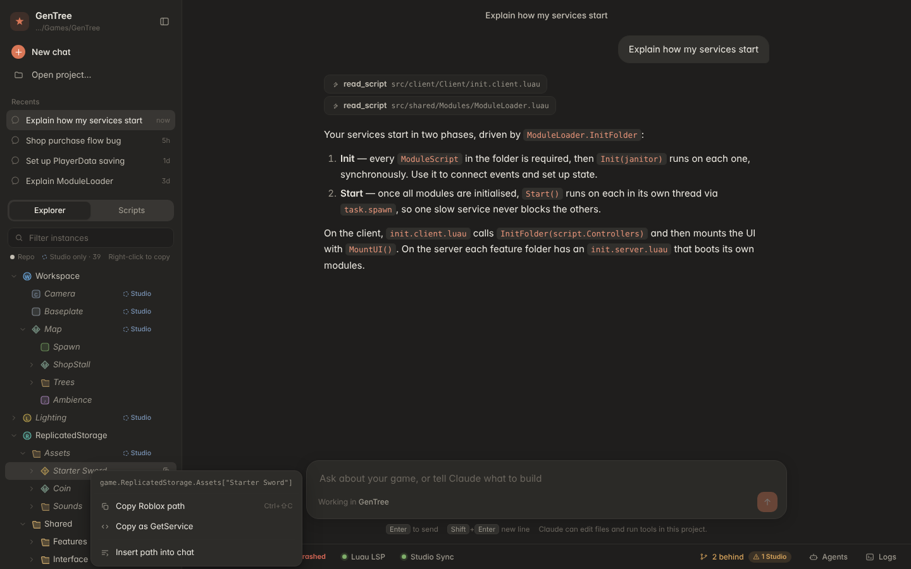

# RBX Forge

A desktop dev harness for Roblox games made from the GenTree template (MyTemplate-Legacy). Open a game folder and Forge runs the tooling for you, shows the game as a Roblox explorer and an organised script list, and gives you a Claude-style chat that can read, edit and test the game.



## Run it

Needs Node 20+, and in the game folder the template's tools (`rokit install`), plus Python 3 for Studio sync.

```bash
npm install
npm run dev      # development, hot reload
npm run build    # production build into out/
npm start        # run the production build
```

Then **Open project** and pick a game folder (one with `default.project.json`). Forge remembers it.

## What it does

- **Services, automatic.** On open it starts the template's `./dev` loop (feature watcher, Blink, sourcemap, wally, Studio sync), `rojo serve`, and luau-lsp. Crashed processes restart with backoff. The status bar shows each one; click for Restart / Stop / Logs.
  - Forge will not run `./dev` inside the template repo itself, because `./dev` disconnects the template's git there. Add `.keep-git` (or set `allowTemplateDisconnect`) if you really want that.
- **Collaborator sync.** The git pill shows ahead/behind/conflicts. Sync now (or every N minutes) commits your work, pulls with rebase, falls back to a merge on conflict and lists conflicted files, then pushes. Never force-pushes. A new game folder has no git (the template's `./dev` removes it); **Init git** in the Sync drawer sets up your shared remote.
- **Studio sync.** Script edits made in Studio (Team Create) come back into the repo through `tools/studio-sync.py`. Conflicts show as a side-by-side diff with *Use Studio version* / *Keep repo version*.
- **Explorer.** The DataModel tree from `default.project.json` and `sourcemap.json`, merged with a live snapshot from the Studio plugin, so models, sounds and GUIs that only exist in Studio show up too (dimmed, marked *Studio*). Needs the template's live-tree plugin update.
- **Scripts.** Every script grouped as Configs, Data, Services, Controllers, Modules, Events, UI and Entry points, with realm and feature tags.
- **Copy path.** Right-click any node: Copy Roblox path (`game.ReplicatedStorage.Assets["Starter Sword"]`), Copy as GetService, Copy file path, Insert path into chat. Ctrl/Cmd-click to select several; Ctrl/Cmd+Shift+C copies.
- **Editor.** Monaco with Luau highlighting and luau-lsp (diagnostics, completion, hover, signature help, go to definition) using Roblox type definitions and API docs, downloaded once and cached.
- **Chat.** Claude through the Claude Agent SDK, with a compact `gentree` MCP toolset: project_overview, list_scripts, read_script, edit_script, write_script, explorer_tree, find_instance, new_feature, sync_collaborators, studio_conflicts, resolve_studio_conflict, service_logs, restart_service. Writes are limited to the Rojo folders and `events.blink`; Packages is off limits. Uses your `ANTHROPIC_API_KEY`, a key pasted into the app (stored with the OS keychain via Electron safeStorage), or an existing Claude Code login.
- **Test agents.** Give one scenario per line and Forge runs them as parallel agents (3 at a time by default), each reporting passed or failed. If Roblox Studio's MCP server is configured (`studioMcp` setting), one agent at a time gets Studio access to play-test; the others review the code.

## Settings

Stored in the app's user data folder (`settings.json`): `model` (default `claude-opus-5-5`), `studioMcp` (`{ "command": "...", "args": [] }`), `allowBash`, `maxParallelAgents`, `agentMaxTurns`, `sync` (`autoSyncMinutes`, `autoCommit`), `allowTemplateDisconnect`.

## Layout

```
src/main        Electron main process
  services/     supervisor, git sync, Studio conflicts, project tree, luau-lsp bridge, settings, logs
  agent/        chat, gentree MCP tools, test agents, credentials
src/preload     the window.harness bridge
src/renderer    React UI (Monaco editor, panels, drawers); mock.ts powers a browser preview
src/shared      types shared by all three
test            node --test suites (npm test)
```

Browser preview with sample data: `npx vite --config src/renderer/vite.preview.config.ts`.

## Status

Built and tested headless: typecheck, 51 unit/integration tests (tree building, categories, git sync against real repos, Studio conflicts, MCP tools, agent scheduling, LSP framing and client), and a production build. Not yet run end to end in a real Electron window against a real game, Studio and API key.
